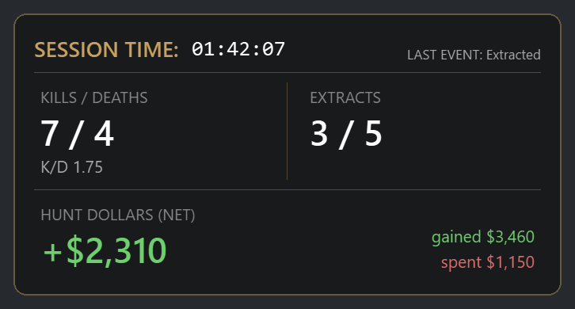

# Taketh Tracker

*Created by **OmniTrickz*** · **Website: [omnitrickz.github.io/hunt-tracker](https://omnitrickz.github.io/hunt-tracker/)**

**A live session stats overlay for Hunt: Showdown 1896.**
It sits in the corner of your screen while you play and keeps score for *this session*: kills, deaths,
extracts, and how many Hunt Dollars you've made or lost. Everything is worked out on your own PC.

*See-through, always on top, and clicks pass straight through it to the game.*

---

## Contents

- [Install](#install)
- [What it tracks](#what-it-tracks)
- [How it works](#how-it-works)
- [Controls](#controls)
- [Fixing a wrong number](#fixing-a-wrong-number)
- [Is it safe? Privacy](#is-it-safe-privacy)
- [Troubleshooting](#troubleshooting)
- [Updates](#updates)
- [Uninstall](#uninstall)

---

## Install

1. Download **`TakethTrackerSetup-x.y.z.exe`** from the [latest release](../../releases/latest), and only
   from there.
2. Run it. Windows will probably say *"Windows protected your PC"*: this free hobby app doesn't have a
   Windows code-signing certificate yet, so Windows can't vouch for who made it. If you downloaded it from
   the link above, click **More info → Run anyway**. Careful users can first compare the file's SHA-256
   (PowerShell: `Get-FileHash .\TakethTrackerSetup-x.y.z.exe`) with the `sha256` in that release's
   `.manifest.json`. Both come from GitHub, so this catches a broken or swapped download, not a
   compromised GitHub account.
3. A **setup window** opens with your **Hunt folder** found automatically (any drive or Steam library).
   Click **Save**. That's it.
4. The overlay appears in the top-right of your main screen, and a **gold icon** appears in
   your tray (bottom-right, near the clock). Right-click that icon for everything else.

**To get good results**

| Do this | Why |
|---|---|
| Play Hunt in **Borderless** (windowed fullscreen) on your **main monitor** | The overlay can't draw over exclusive fullscreen, and only the main monitor is read |
| Keep the game in **English**, with Windows' **English (United States)** language installed | The Mission Summary is read as text by Windows' English text recognition (the app warns you if it's missing) |
| Use a **16:9** screen (1080p, 1440p, 4K) | Screen positions are tuned for 16:9; ultrawide may miss kills/money |
| After a match, **stay on the Mission Summary about 10-15 seconds**, with Hunt in front, until your kills and Hunt Dollars update on the overlay | Kills show in ~2 s, Hunt Dollars ~10-15 s in. Skipped it? Open **View Last Mission** and press **Ctrl+Shift+R**, or use **Adjust stats** |

---

## What it tracks

| On the overlay | What it means |
|---|---|
| **Kills / Deaths** | Hunters you killed and times you died this session, plus your session K/D |
| **Extracts** | Matches you got out of alive, out of matches played (e.g. `3 / 5`) |
| **Hunt Dollars (net)** | Your lobby balance now minus your balance when the session started. Green = up, red = down |
| ↳ gained / spent | From your lobby balance: every rise is **gained** (match payouts, challenge rewards), every drop is **spent** (hunters, gear, restocks). Gained − spent = net |
| Timer | How long this session has been running |

Don't want one of these on screen? Press **Ctrl+Shift+E** and use **Hide Time** (the session timer and last
event at the top), **Hide K/D**, **Hide Extracts** or **Hide Hunt $** under *Hide info*. They're still tracked (and in Session history), just not shown.

A **session** starts when you open the app (or press **Reset All**), and is saved to your session history.
If the app is restarted within 30 minutes, it carries on the same session.

**Session history** (tray menu) shows your totals for the last 7 days, 30 days or all time (time played,
K/D, extract rate, Hunt Dollars, best match), charts of K/D, kills and deaths, and net Hunt Dollars per session,
how many kills you usually get per match, and every session with its individual matches.

---

## How it works

Taketh Tracker never touches the game. It only looks at things Hunt already puts on your disk and screen.

### 1. Hunt's log file: matches, deaths, extracts

Hunt writes a running log (`Hunt Showdown 1896\USER\Game.log`). The tracker follows it, line by line:

- **A match loading** → `matches + 1`.
- **The death screen opening** → `deaths + 1`. Hunt often shows the death screen more than once per death
  (downed → burned → spectating), so death screens close together count as one.
- **The Mission Summary opening** → the match is over. If your last death was within 90 seconds of it,
  you died out; otherwise you made it out and it counts as an **extract** (being revived and extracting
  still counts).
- **The shooting range or tutorial loading** → ignored completely.

### 2. The Mission Summary: kills and Hunt Dollars earned

Hunt doesn't write kills or rewards to the log, so when the summary opens the tracker **reads the screen**
with Windows' built-in text recognition:

- **"Hunters Killed +N"**: read about 2 seconds in.
- **Total Rewards**: the reward next to the **skull-coin icon** is your Hunt Dollars (it finds the icon
  itself, so a missing reward can't make it grab the wrong number), read about 15 seconds in.

The numbers count up as they animate in, so each one is only accepted once it has **held the same value
for a second**. It looks about every 0.6 seconds for 40 seconds (longer, up to 90, while the summary is
still on screen), and only while the game itself (`HuntGame.exe`) is the active window, so a browser tab or
video about Hunt is never read.

The summary's Hunt Dollars show on the overlay straight away; once you're back in the lobby, the balance
takes over (see below). If a summary was skipped or misread, the match still gets its Hunt Dollars from the
balance.

### 3. The lobby: your Hunt Dollar balance

Every 10 seconds while you're in menus (never during a match), it reads the balance next to the skull coin
in the lobby's top-left bar. The **first read** of a session is your starting point; **net** is the
difference since then. Every rise in the balance counts as **gained** and every drop as **spent**, so the
three always add up, and a skipped Mission Summary can't lose a payout. A balance that jumps and goes
straight back (a misread) is ignored.

---

## Controls

### Hotkeys

| Keys | Does |
|---|---|
| **Ctrl+Shift+H** | Show / hide the overlay |
| **Ctrl+Shift+E** | **Edit mode**: move, resize, adjust and reset (see below). Press again to lock |
| **Ctrl+Shift+R** | Re-read the last match's Mission Summary (replaces that match's kills and money; doesn't add a match) |
| **Ctrl+Shift+Q** | Quit |

### Edit mode (Ctrl+Shift+E)

The overlay gets a gold border and a control bar appears underneath it:

- **Drag** the overlay anywhere (any monitor).
- **Resize** with the **mouse wheel** over it, or **− / +** (60%-250%). Size and position are remembered.
- **Adjust**: `[−] Kills [+]`, `[−] Deaths [+]`, `[−] Extracts [+]`, `[−] Attempts [+]`, and **Modify $**.
- **Reset K/D**, **Reset Extracts**, **Reset Hunt Dollars**, **Undo last match**, **Reset All**.

Press **Ctrl+Shift+E** again (or **Done**) and it goes back to see-through and click-through.

### Tray menu (right-click the skull-coin icon)

Show/hide · Move/resize · Read summary now · Undo last match · **Adjust stats** · **Reset** ·
Session history · Stream window (for Discord) · Start with Windows · Settings · Open data folder ·
Check for updates · Quit.

**Streaming on Discord:** sharing your **Screen** shows the overlay on top of the game. Sharing just the
Hunt **window** won't include it. For that, use **Stream window** and share it on its own.

**Streaming with OBS (one PC or two):** Ctrl+Shift+E > **OBS setup** walks you through it. The easiest way is a
**Browser Source**: click **Turn on**, copy the address it shows, and paste it into an OBS Browser source, on
this PC or on a separate streaming PC on the same home network. The background is see-through and it updates
every second. It's off until you turn it on, only shows your stats, and the address has a random key in it.

---

## Fixing a wrong number

| Problem | Fix |
|---|---|
| A match's kills or money were missed | Open that match's summary (**View Last Mission**), press **Ctrl+Shift+R** and leave it up ~20 s; or use **Adjust stats** / edit mode |
| Something counted that shouldn't have | **Undo last match** removes the latest match entirely |
| Start one stat over | **Reset K/D**, **Reset Extracts** or **Reset Hunt Dollars** |
| Start everything over | **Reset All** (the old session stays in Session history) |

Adjustments never go below 0. **Modify $** adds to (or, with a minus sign, takes from) both your **net** and
**gained**, so *spent* stays the same. **Reset Hunt Dollars** clears manual corrections too.

---

## Is it safe? Privacy

- **What it does to the game: nothing.** It doesn't read or change game memory, inject anything, or draw
  inside the game. The overlay is an ordinary window on top. It reads Hunt's log file and the screen.
  We can't speak for Crytek or Easy Anti-Cheat; only they decide what their anti-cheat allows.
- **No screenshots are kept.** Each screen grab is read in memory and thrown away immediately.
- **What goes over the internet:** only an update check to this GitHub page when the app opens and every
  30 minutes. Your stats never leave your PC, and the app doesn't need your Steam ID or any account.
  Text recognition is done by Windows, on your PC.
- **Your data stays on your PC**, in `%LOCALAPPDATA%\HuntTracker`: settings, session history (a few KB
  each) and a log that rotates so it never grows past ~1.5 MB.

Found a security problem? See [SECURITY.md](SECURITY.md).

Not made by or affiliated with Crytek.

---

## Troubleshooting

| Symptom | Likely cause |
|---|---|
| Overlay doesn't show over the game | Hunt is in exclusive fullscreen; switch to **Borderless** |
| Kills / money never update | Summary skipped too fast, Hunt not in front, game not in English, or not 16:9 |
| Hunt Dollars shows "net counts after a lobby visit" | It hasn't seen your lobby yet this session. It will on your next visit |
| No matches counted at all | Wrong Hunt folder; fix it in **Settings** |
| A hotkey does nothing | Another app uses it; every action is also in the tray menu |

The log (`tracker-log.txt`, tray → **Open data folder**) records what was read for each match.

---

## Updates

When you open Taketh Tracker it checks this page right away. If there's a new release, it shows what's new and
asks **Install now / Later**. Install now downloads it, closes Taketh Tracker, installs, and starts it again,
with your session and settings kept.

While it's running it also checks every 30 minutes: you get a notification, plus an **Update to vX.Y.Z** button
in Ctrl+Shift+E and **Install update** in the tray menu. **Check for updates** in the tray checks any time.

**Updates are signed.** Each release has a manifest (version, file name and SHA-256 of the installer)
signed with OmniTrickz's release key, which is encrypted with a passphrase and kept off GitHub; a second,
offline backup key can replace it if it's ever lost or leaked. Before installing, the app checks that
signature, that the version is newer than yours (so an old release can't be pushed again as an "update"),
and that the download matches the manifest. A tampered or fake update is refused, *unless* someone also
gets hold of the signing key and its passphrase, which is why they're kept separate from the GitHub login.

Versions 1.0.0 to 1.0.4 don't check signatures at all. If you're on one of those, please update now.

## Uninstall

Windows **Settings → Apps → Taketh Tracker → Uninstall**. It removes only the files it installed. Your
session history in `%LOCALAPPDATA%\HuntTracker` is kept unless you delete that folder.
